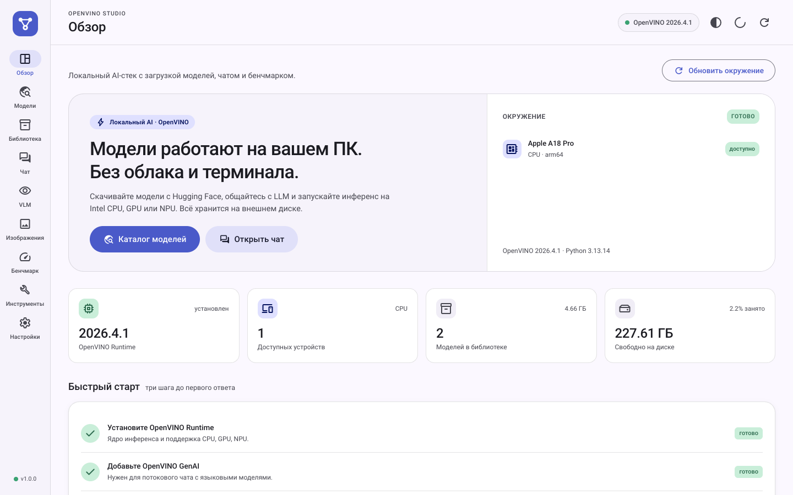
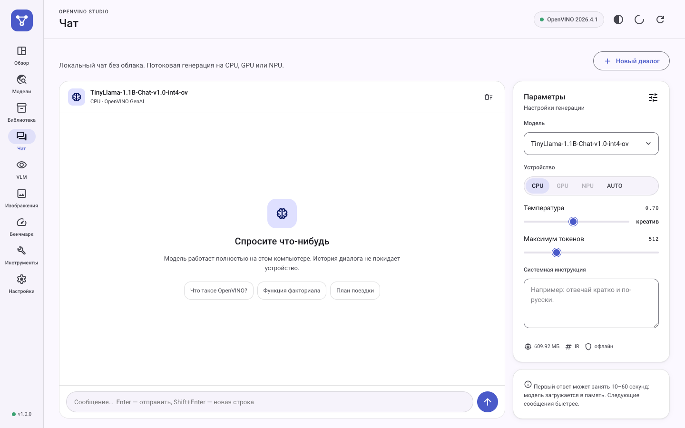
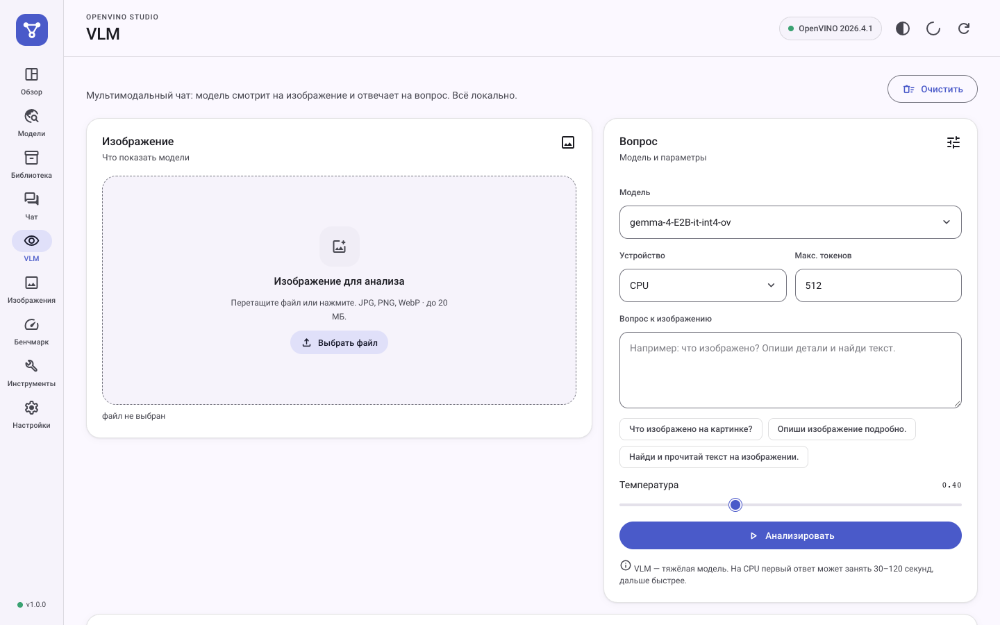
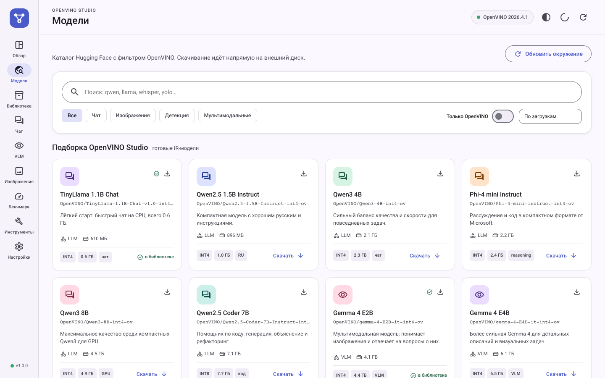
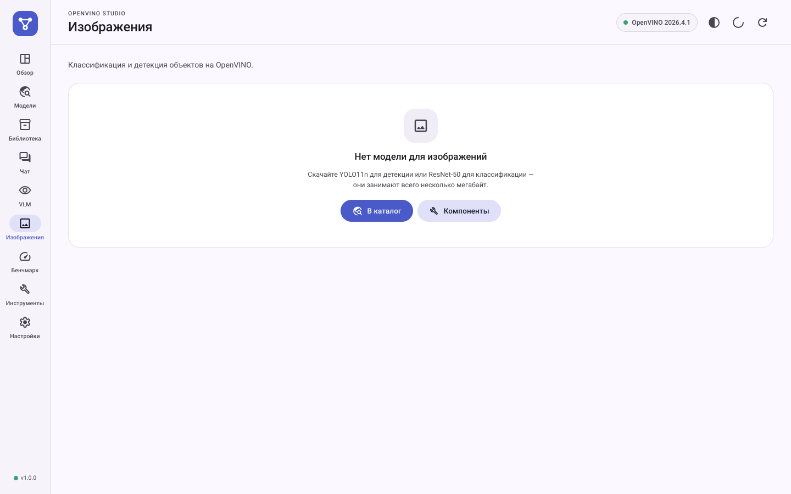

# OpenVINO Studio

<p align="center">
  
</p>

<p align="center">
  Локальный ИИ на вашем ПК — без облака и терминала.<br>
  <a href="https://kirilldual0987.github.io/openvino-studio/">Сайт проекта</a> ·
  <a href="https://github.com/kirilldual0987/openvino-studio/releases/latest">Скачать</a> ·
  <a href="https://github.com/kirilldual0987/openvino-studio/issues">Сообщить о проблеме</a>
</p>

**OpenVINO Studio** — настольное приложение с графическим интерфейсом для работы с моделями Intel OpenVINO. Скачивание моделей, чат с LLM, визуально-языковые модели (VLM), классификация и детекция изображений, бенчмарк и конвертация в OpenVINO IR — всё в одном окне, без командной строки.



## Возможности

- **Каталог моделей** — проверенные OpenVINO-модели с Hugging Face и поиск по репозиториям. Прогресс, ETA, докачка и отмена загрузки.
- **Чат с LLM** — потоковые ответы, температура, top-p, top-k, системная инструкция, остановка генерации.
- **VLM** — загрузите изображение и задайте вопрос модели (Gemma 4, Qwen2-VL, InternVL2 и другие).
- **Изображения** — YOLO-детекция и классификация ResNet/MobileNet с превью и результатами.
- **Бенчмарк** — latency, throughput, TTFT и история замеров для выбранного устройства.
- **Конвертация** — Hugging Face → OpenVINO IR в INT4, INT8 или FP16 через Optimum Intel.
- **Компоненты** — установка OpenVINO Runtime, GenAI и инструментов конвертации в отдельное окружение рядом с приложением.
- **Встроенное окно** — интерфейс открывается в отдельном окне на Qt WebEngine (Chromium), без браузера и вкладок.
- **Всё локально** — модели, кэш, окружение и журналы остаются на вашем диске.

## Интерфейс

Спокойный Material Design 3: плоские поверхности, скругления, никаких градиентов. Светлая и тёмная темы, адаптивная вёрстка.

| Чат | VLM |
|---|---|
|  |  |

| Каталог | Изображения |
|---|---|
|  |  |

## Быстрый старт

### Windows

1. Скачайте архив `OpenVINO-Studio-Windows.zip` со [страницы релизов](https://github.com/kirilldual0987/openvino-studio/releases/latest) и распакуйте.
2. Запустите `OpenVINO Studio.vbs` — откроется встроенное окно приложения без консоли.
3. В разделе **«Инструменты» → «Компоненты»** установите **OpenVINO Runtime** и **OpenVINO GenAI**.
4. Откройте **«Модели»**, выберите модель и нажмите **«Скачать»**.
5. Работайте в разделах **«Чат»**, **«VLM»**, **«Изображения»** или **«Бенчмарк»**.

### macOS

1. Скачайте `OpenVINO-Studio-macOS.zip` и распакуйте целиком.
2. Запустите `launchers/macos/OpenVINO Studio.app` (при первом запуске — правый клик → «Открыть»). Интерфейс откроется во встроенном окне.
   Не переносите один `.app` в «Программы»: рядом должна оставаться папка `app`.
   Если macOS ругается на повреждение: `xattr -dr com.apple.quarantine "/путь/к/OpenVINO Studio/launchers/macos/OpenVINO Studio.app"`.
3. Дальше — как в Windows.

### Linux

1. Скачайте `OpenVINO-Studio-Linux.tar.gz` и распакуйте.
2. Запустите `launchers/linux/start-openvino-studio.sh` или установите ярлык: `launchers/linux/install-launcher.sh`.

### Требования

- Python 3.10–3.14 (для Windows-сборки нужен установленный Python; остальные зависимости ставятся автоматически).
- При первом запуске автоматически скачивается PySide6 (Qt WebEngine, ~500 МБ).
- Linux: нужны обычные графические библиотеки (OpenGL/X11 или Wayland); на минимальных серверах окно не откроется.
- Windows 10/11, macOS 12+ или Linux x86_64.
- 8–16 ГБ ОЗУ для больших моделей и свободное место на диске.

## Что нового в 1.1.6

- Заголовок встроенного окна больше не дублирует название приложения.
- Процесс окна запускается через консольный Python без видимого окна — стабильнее на Windows.
- Мелкие правки запуска и логов.

## Что нового в 1.1.5

- **Собственный Chromium-движок** Qt WebEngine в отдельном окне на Windows, macOS и Linux — пользовательский браузер не нужен.
- PySide6 (~500 МБ) скачивается и ставится автоматически при первом запуске.
- Если движок недоступен, используется запасной встроенный WebView; при полном сбое показывается адрес и журнал.
- **Windows:** исправлен запуск из папки с пробелами, добавлена поддержка Python из Microsoft Store.
- **macOS:** приложение само находит папку проекта; ошибки показываются нативным диалогом.
- **Закрытие окна** останавливает локальный сервер.

## Как это устроено

Приложение состоит из локального HTTP-сервера на стандартной библиотеке Python и одностраничного интерфейса. Сервер не требует сторонних пакетов; OpenVINO и GenAI устанавливаются в отдельное виртуальное окружение на диске и используются рабочими процессами.

```
OpenVINO Studio/
├── OpenVINO Studio.vbs        # запуск на Windows без консоли
├── Create Desktop Shortcut.vbs
├── app/
│   ├── server.py              # локальный HTTP-сервер и API
│   ├── bootstrap.pyw          # первый запуск: окружение, зависимости, окно
│   ├── core/                  # настройки, модели, задания, Hugging Face
│   ├── workers/               # чат, VLM, изображения, бенчмарк, конвертация
│   └── web/                   # интерфейс (HTML/CSS/JS, без сборки)
├── launchers/                 # macOS .app и Linux-скрипты
├── docs/                      # сайт проекта для GitHub Pages
├── models/                    # сюда скачиваются модели
└── runtime/                   # окружение, кэш, журналы, настройки
```

## Разработка

```bash
python3 app/server.py --port 8765
```

Откройте `http://127.0.0.1:8765`. Сервер не требует зависимостей; для режимов инференса установите компоненты через интерфейс или вручную:

```bash
python3 -m pip install openvino openvino-genai pillow
```

Сайт проекта лежит в `docs/` и публикуется через GitHub Pages.

## Лицензия

MIT. © 2026 **ByKirilldual0987**.

OpenVINO и Intel — товарные знаки Intel Corporation. Проект не связан с Intel и не спонсируется ею. Модели на Hugging Face распространяются под своими лицензиями — проверяйте их перед использованием.
